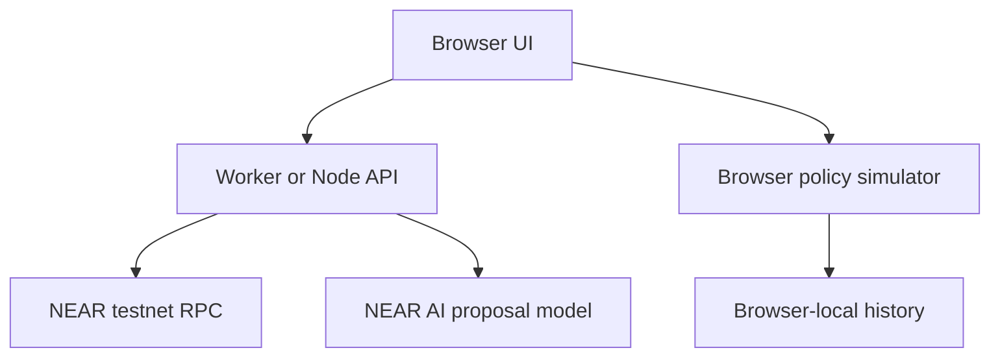

# Cadrotsentry

**A counterparty-check prototype for AI agents that pay.** A Cadrots project for NEAR Hackathon Track 06: AI Security & Defense (`security`).

An agent submits its proposed payment receiver. Cadrotsentry is intended to collect receiver evidence, return **allow / warn / block with reasons**, and enforce that decision before the agent signs. The focused extension is detecting changes in approved receiver conditions and requiring fresh review.

> **Current status:** runnable prototype with a live-RPC read-only inspection adapter, a separate seeded payment simulator, and an optional server-side NEAR AI proposal lab. No real payment signing, deployed vault or authenticated approval is implemented. Not submission-complete against the scoped-key requirement. Live external RPC and model calls still require verification in your environment.

## Problem and solution

AI purchasing agents can propose payments to unfamiliar receivers or follow malicious instructions in supplier content. Businesses need evidence and execution boundaries, not an unverified “safe” label.

Our intended flow is: trusted owner intent → agent proposal → receiver evidence → policy decision → human review when needed → restricted signing → confirmed outcome. A new receiver or code change is a reason for review, not proof of fraud. An allow decision means configured checks passed, not a safety guarantee.

## Run locally

Use Node.js 22.9+ and Git. The sample demo needs no npm dependencies or API credentials.

If you have the full Git bundle, clone it into a new folder to keep your previous checkout as a backup. In PowerShell:

```powershell
cd "$env:USERPROFILE\Documents\GitHub"
git clone --branch main "$env:USERPROFILE\Downloads\cadrotsentry-current.bundle" cadrotsentry-current
cd cadrotsentry-current
npm test
npm run dev -- --port 3003
```

Open [http://localhost:3003](http://localhost:3003). Stop the server with Ctrl+C. If the port is already in use, choose another port and open the URL printed in the terminal.

The bundle contains the full committed project and history. It excludes local secrets and generated files. If you already have NEAR AI configured, you can copy your private `.env` from the old checkout before starting the new server. The sample flows work without it.

Once the latest version is on GitHub, new users can clone [the repository](https://github.com/khyuannn/cardrotsentry-secu) directly and run the same npm commands. Use this one checkout for future changes, with ordinary commits and branches. `npm run build` generates the worker files. `npm run demo:attack` prints the simulated refusal log.

## Deploy on Vercel

Import this repository into [Vercel](https://vercel.com/new). Choose **Other** if asked for a framework preset, use the repository root, and leave the output directory override off. The checked-in `vercel.json` runs `npm run build:vercel` and packages the app and server endpoints together. Start with sample proposals. They need no environment variables.

Once deployed, open the production URL and check **Payment workspace → Subscription renewal**. The separate **Check a receiver** screen makes a read-only testnet query. If you connect the repository with `main` as the production branch, subsequent pushes to `main` trigger a new production build.

## What works now

| Component | Actual behavior |
| --- | --- |
| Live receiver check | User-entered `.testnet` or implicit account; server queries finalized RPC account metadata and returns source/time/block references. |
| Incomplete data handling | Historical activity, deployment dates, prior interactions and reviewed reports remain explicitly unknown. Incomplete inspection warns and issues no authorization. |
| Payment simulator | Six scenarios: normal supplier, changed destination, changed contract, blocked receiver, missing history, and subscription renewal. |
| Simulated approval | Exact proposal/evidence binding, expiry and single-use checks. Browser role only, not authenticated security. |
| Decision history | Browser-local event history, payment receipts and JSON export. |
| Attack replay | Recorded compromised proposal to a seeded demo-blocklisted receiver; simulated wrapper refuses signing. |
| NEAR AI lab | Server-only bounded model call with proposal validation. Requires your replacement API secret and exact model ID. Advisory only, not connected to execution. |

The live inspection is separate from the sample payment flow. It does not authorize purchases or feed live evidence into simulated payments. A provider outage never substitutes seeded evidence as live evidence.

## Organizer requirement checklist

| Requirement | Status | Remaining work |
| --- | --- | --- |
| Account age and activity | **Pending live history** | Connect an indexer with coverage, verified timestamps and unknown handling. Current RPC does not supply account age. |
| Contract presence and recent code changes | **Partial** | Current code metadata queried; live deployment history/change monitoring still needed. |
| Prior agent–receiver interactions | **Simulation only** | Confirmed server-side records and receipt verification. |
| Shared blocklist with evidence reports | **Simulation only** | Authenticated submissions, evidence storage, review and active-list policy. |
| Allow/warn/block plus reasons | **Implemented in simulation; live inspection partial** | Connect full verified evidence to server-owned policy. |
| Wrapper refuses block; warn asks human | **Simulation only** | Authenticated server review and real pre-signing enforcement. |
| Scoped function-call signing key, no agent full-access key | **Not implemented** | Deploy/test vault, register key and verify its permissions through RPC. |
| Injected-agent attack script and log | **Simulated recorded proposal** | Add live model experiment and real restricted-key execution boundary; report if model resists injection. |
| Key limitations in README | **Documented below** | Add actual deployed scope/method/allowance after setup. |

## NEAR AI credits

1. Revoke the key exposed in the earlier screenshot and generate a replacement in its issuing dashboard.
2. Choose a model and copy its exact API ID from the current catalog.
3. Run `Copy-Item .env.example .env` on Windows. Fill `NEAR_AI_API_KEY` and `NEAR_AI_MODEL` locally.
4. Restart `npm run dev`. Open **AI purchase demo**, send one short offer and inspect response/usage.

Never commit `.env`, expose a key in browser code, or paste it in issues. The backend calls `https://cloud-api.near.ai/v1/chat/completions`. It limits supplier text to 3000 characters, requests at most 300 output tokens, validates returned fields and times out. Check the selected model's parameter support; adapt unsupported output parameters without removing limits. Live model inference has not been tested with a replacement key.

AI credits pay for inference, not NEAR gas or vault funds. A local `.env` does not configure the separately hosted demo. Hosted secrets need configuration and redeployment. There is no durable hosted rate limiter/billing cap: keep inference access private and add limits before wider access.

## Try a subscription renewal

1. Open **Payment workspace** and select **Subscription renewal → Check payment**. The proposed renewal matches the approved 2 NEAR monthly price.
2. Click **Simulate renewal price increase** before completing the payment. The price changes to 3 NEAR and needs review.
3. Click **Test previous approval**. The receipt shows 0 NEAR simulated spend. Expand **View receipt details** to see both prices.
4. Click **Reject** to stop the renewal, or choose **Approve demo payment → Simulate payment** to record 3 NEAR in simulated spend.
5. Open **Decision history** to see the recorded decisions and outcomes.

You can also try **Blocked receiver → Check payment** to see a policy refusal, **Incident replay** to see the recorded redirection example, or **Check a receiver** for a read-only NEAR testnet account lookup. The payment and renewal flows use simulated funds.

## Architecture



Planned security boundary: server-owned intent/policy and durable evidence → authenticated human review → isolated policy signer → agent wrapper → Rust payment vault. It is not implemented by this diagram or by the browser simulator.

## Access-key limits and intended payment design

A standard NEAR function-call access key restricts calls to one `receiver_id`, optionally specific `method_names`, with a gas `allowance`. It cannot directly transfer native NEAR, attach NEAR deposits, deploy code, or manage keys. Its gas allowance is not the business purchase budget. Omitted method restrictions can allow all methods; specify an explicit method list. Keep owner recovery separate and account for exhausted gas allowance.

The intended design uses a prefunded vault: agent calls its explicit payment method with zero attached deposit, and the vault enforces signed authorization, recipient/amount binding, spending caps, expiry and replay protection before transferring its own funds. A scoped key alone does not validate payment arguments. Agent must never receive the owner's full-access key or the isolated policy signer's secret.

Receiver evidence changes must revoke outstanding authorization through a verified contract-enforced design; offchain database edits alone do not invalidate a previously signed permit. Offchain code checks also do not atomically guarantee external code is unchanged at execution.

## Data sources

| Signal | Source | Retrieval and limits |
| --- | --- | --- |
| Current account/code | NEAR testnet JSON-RPC | `query` / `view_account` / `finality=final`; account code metadata is not a safety verdict. |
| Age/activity | NearBlocks testnet indexer (planned) | Verify current API/version/auth; distinguish creation time from first observed activity. |
| Deployment changes | Indexer deployment history plus saved RPC snapshots (planned) | Current code hash alone cannot determine deployment age. |
| Prior interactions | Confirmed execution database plus chain receipts (planned) | Identify ultimate recipient, not only vault transaction receiver. |
| Shared reports | Authenticated reviewed registry (planned) | Evidence required; pending allegations cannot automatically become verified blocks. |

Mainnet and testnet evidence must never be mixed. Bound history windows and disclose missing coverage. Attribution for NearBlocks must be added when its API is used.

## Tests and limits

`npm test` checks simulator decisions, changed evidence, amount/receiver mutation, expiry, replay, missing authorization and mocked RPC success/error/schema paths. `npm run demo:attack` asserts a simulated denial. These are not smart-contract tests, live-provider verification or a security audit.

No authenticated reviewer, durable server history, shared report registry, real signer, deployed contract, payment settlement or cryptographic policy permit is delivered. No claim of first invention: agent custody/policy tools and payment-agent attack testing already exist. The proposed product focus needs validation against existing tools and customer needs.

## Next milestone

Follow [NEXT_STEPS.md](NEXT_STEPS.md). **First run the app locally and verify a real receiver query. Then configure one NEAR AI call.** After that connect full evidence and server-owned review before attempting real signing. [Cadrotsentry_BUILD_GUIDE.md](Cadrotsentry_BUILD_GUIDE.md) is the original proposed architecture; its Rust/SQLite sections describe future work, not existing components.

## References

- [Organizer Track 06 prompt](https://github.com/nearai/near-hackathon-prompt-examples/blob/main/tracks/06-security.md)
- [Current hackathon site](https://nearhackathon.com/)
- [NEAR RPC account queries](https://docs.near.org/api/rpc/contracts)
- [NEAR access keys](https://docs.near.org/protocol/accounts-contracts/access-keys)
- [NEAR AI quickstart](https://docs.near.ai/cloud/quickstart)
- [NEAR AI model catalog guidance](https://docs.near.ai/cloud/models)

Built with AI-assisted implementation. This repository documents actual delivered behavior separately from planned security features; follow the organizer's current disclosure requirements when submitting.
