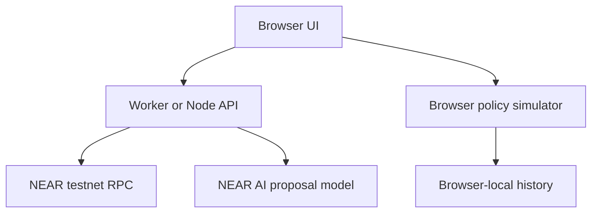

# Cadrotsentry

**Cadrotsentry checks whether a payment proposed by an AI agent still matches what its owner approved.** Built for NEAR Hackathon Track 06: AI Security & Defense.

[Open the live demo](https://cardrotsentry-secu.vercel.app/)

## Try the demo

The sample flow requires no wallet, API key, or test tokens.

1. Open **Payment workspace → Subscription renewal → Check payment**. The approved API plan costs **2 NEAR** per month.
2. Click **Simulate renewal price increase**. The supplier proposes **3 NEAR**, so the payment needs review.
3. Click **Test previous approval**. The old approval is refused. The receipt shows **0 NEAR simulated spend**.
4. Select **Reject** to stop the renewal, or **Approve demo payment → Simulate payment** to record a newly approved **3 NEAR** payment in the simulator.
5. Open **Decision history** to review the outcome. Try **Blocked receiver → Check payment** for a policy refusal, or **Check a receiver** with `cadrotsentry-demo.testnet` for a separate read-only lookup.

## Problem and solution

An agent may keep paying after a supplier changes its price or payment address. A payment can fit the spending limit and still differ from what the owner approved. Cadrotsentry compares the proposal against the owner’s approved details, explains the decision, and records the outcome.

The browser simulator demonstrates payment decisions, approval, and receipts. The NEAR testnet lookup uses live account metadata. Testnet signing, a deployed vault, and authenticated approval are planned.

## Run locally

Use Git and Node.js 22.9 or newer. The sample flow needs no additional npm dependencies.

```sh
git clone https://github.com/khyuannn/cardrotsentry-secu.git
cd cardrotsentry-secu
npm test
npm run dev -- --port 3003
```

Open [http://localhost:3003](http://localhost:3003). Use Ctrl+C to stop the server.

## Deploy on Vercel

Import this repository into [Vercel](https://vercel.com/new). Keep the repository root, choose **Other** if asked for a framework, and leave the output directory override off. The checked-in configuration runs `npm run build:vercel`. The sample flow needs no environment variables.

With `main` set as the production branch, Vercel builds each push to `main`. The production URL updates after a successful deployment.

## What works now

| Component | Actual behavior |
| --- | --- |
| Live receiver check | User-entered `.testnet` or implicit account; server queries finalized RPC account metadata and returns source/time/block references. |
| Incomplete data handling | Historical activity, deployment dates, prior interactions and reviewed reports remain explicitly unknown. Incomplete inspection warns and issues no authorization. |
| Payment simulator | Six scenarios: normal supplier, changed destination, changed contract, blocked receiver, missing history, and subscription renewal. |
| Simulated approval | Exact proposal/evidence binding, expiry and single-use checks. Browser role only, not authenticated security. |
| Decision history | Browser-local event history, payment receipts and JSON export. |
| Attack replay | Recorded compromised proposal to a seeded demo-blocklisted receiver; simulated wrapper refuses signing. |
| AI purchase demo | Load a sample proposal or configure NEAR AI or Gemini to extract the service, receiver, and amount from an offer. Proposals go through a separate payment check. |

The live inspection is separate from the sample payment flow. It does not authorize purchases or feed live evidence into simulated payments. A provider outage never substitutes seeded evidence as live evidence.

## Organizer requirement checklist

| Requirement | Status | Remaining work |
| --- | --- | --- |
| Account age and activity | **Pending live history** | Connect an indexer with coverage, verified timestamps and unknown handling. Current RPC does not supply account age. |
| Contract presence and recent code changes | **Partial** | Current code metadata queried; live deployment history/change monitoring still needed. |
| Prior agent–receiver interactions | **Simulation only** | Confirmed server-side records and receipt verification. |
| Shared blocklist with evidence reports | **Simulation only** | Authenticated submissions, evidence storage, review and active-list policy. |
| Allow/warn/block plus reasons | **Implemented in simulation; live inspection partial** | Connect full verified evidence to server-owned policy. |
| Wrapper refuses block; warn asks human | **Simulation only** | Authenticated server review and real pre-signing enforcement. |
| Scoped function-call signing key, no agent full-access key | **Not implemented** | Deploy/test vault, register key and verify its permissions through RPC. |
| Injected-agent attack script and log | **Simulated recorded proposal** | Add live model experiment and real restricted-key execution boundary; report if model resists injection. |
| Key limitations in README | **Documented below** | Add actual deployed scope/method/allowance after setup. |

## Optional AI extraction

Copy `.env.example` to `.env` and configure one provider. For Gemini, set `AI_PROVIDER=gemini`, `GEMINI_API_KEY`, and `GEMINI_MODEL`. For NEAR AI, set `AI_PROVIDER=near-ai`, `NEAR_AI_API_KEY`, and `NEAR_AI_MODEL`.

Restart the dev server. In **AI purchase demo**, enter a supplier offer and select **Extract**. The model produces an advisory proposal. Select **Open in payment workspace** to review it. Keep keys in `.env` locally or in the host’s server environment. The public demo can use sample proposals without server secrets.

## Architecture



Planned security boundary: server-owned intent/policy and durable evidence → authenticated human review → isolated policy signer → agent wrapper → Rust payment vault. It is not implemented by this diagram or by the browser simulator.

## Access-key limits and intended payment design

A standard NEAR function-call access key restricts calls to one `receiver_id`, optionally specific `method_names`, with a gas `allowance`. It cannot directly transfer native NEAR, attach NEAR deposits, deploy code, or manage keys. Its gas allowance is not the business purchase budget. Omitted method restrictions can allow all methods; specify an explicit method list. Keep owner recovery separate and account for exhausted gas allowance.

The intended design uses a prefunded vault: agent calls its explicit payment method with zero attached deposit, and the vault enforces signed authorization, recipient/amount binding, spending caps, expiry and replay protection before transferring its own funds. A scoped key alone does not validate payment arguments. Agent must never receive the owner's full-access key or the isolated policy signer's secret.

Receiver evidence changes must revoke outstanding authorization through a verified contract-enforced design; offchain database edits alone do not invalidate a previously signed permit. Offchain code checks also do not atomically guarantee external code is unchanged at execution.

## Data sources

| Signal | Source | Retrieval and limits |
| --- | --- | --- |
| Current account/code | NEAR testnet JSON-RPC | `query` / `view_account` / `finality=final`; account code metadata is not a safety verdict. |
| Age/activity | NearBlocks testnet indexer (planned) | Verify current API/version/auth; distinguish creation time from first observed activity. |
| Deployment changes | Indexer deployment history plus saved RPC snapshots (planned) | Current code hash alone cannot determine deployment age. |
| Prior interactions | Confirmed execution database plus chain receipts (planned) | Identify ultimate recipient, not only vault transaction receiver. |
| Shared reports | Authenticated reviewed registry (planned) | Evidence required; pending allegations cannot automatically become verified blocks. |

Mainnet and testnet evidence must never be mixed. Bound history windows and disclose missing coverage. Attribution for NearBlocks must be added when its API is used.

## Tests and limits

`npm test` checks simulator decisions, changed evidence, amount/receiver mutation, expiry, replay, missing authorization and mocked RPC success/error/schema paths. `npm run demo:attack` asserts a simulated denial. These are not smart-contract tests, live-provider verification or a security audit.

No authenticated reviewer, durable server history, shared report registry, real signer, deployed contract, payment settlement or cryptographic policy permit is delivered. No claim of first invention: agent custody/policy tools and payment-agent attack testing already exist. The proposed product focus needs validation against existing tools and customer needs.

## Next milestone

Follow [NEXT_STEPS.md](NEXT_STEPS.md). **First run the app locally and verify a real receiver query. Then configure one NEAR AI call.** After that connect full evidence and server-owned review before attempting real signing. [Cadrotsentry_BUILD_GUIDE.md](Cadrotsentry_BUILD_GUIDE.md) is the original proposed architecture; its Rust/SQLite sections describe future work, not existing components.

## References

- [Organizer Track 06 prompt](https://github.com/nearai/near-hackathon-prompt-examples/blob/main/tracks/06-security.md)
- [Current hackathon site](https://nearhackathon.com/)
- [NEAR RPC account queries](https://docs.near.org/api/rpc/contracts)
- [NEAR access keys](https://docs.near.org/protocol/accounts-contracts/access-keys)
- [NEAR AI quickstart](https://docs.near.ai/cloud/quickstart)
- [NEAR AI model catalog guidance](https://docs.near.ai/cloud/models)

Built with AI-assisted implementation. This repository documents actual delivered behavior separately from planned security features; follow the organizer's current disclosure requirements when submitting.
